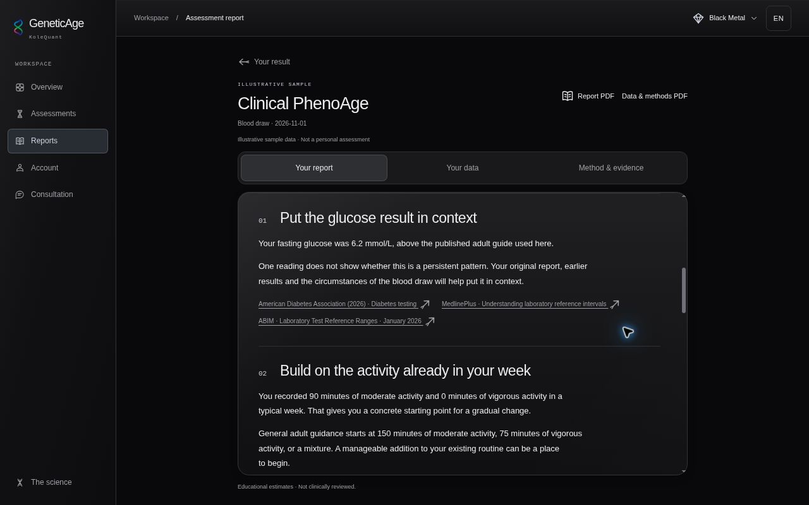
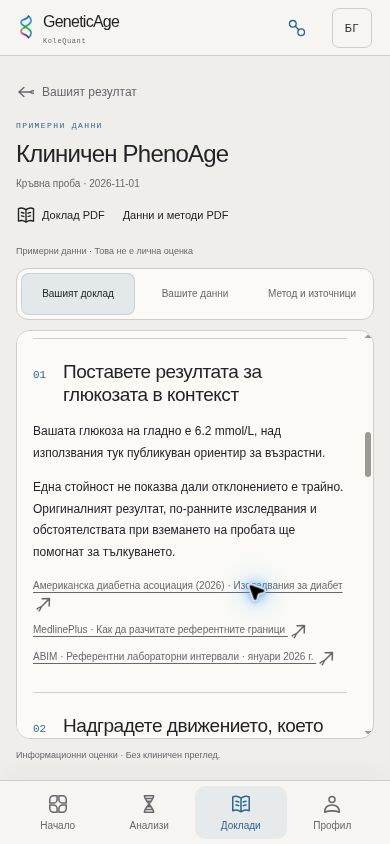

# Personal report review — 9 November 2026

The screenshots use the application's explicitly labelled illustrative sample. No personal health records, account credentials or payment details were used.

## Automated checks

- `npm run check`: locale parity, ESLint, TypeScript and the complete test suite.
- `npm run build`: production Worker/client build.
- `npm run build:pages`: the static browser build used for visual review.
- Focused checks cover deterministic composition, supplied-result preservation, all report families, exact values/units, frozen prose/citations, missing and withheld results, encrypted persistence, access boundaries, browser-print scope and restoration.
- All 103 editorial templates are checked against their expanded Bulgarian translations, including bound numbers, units and model names.

## Browser review

Reviewed the actual static app build in Chromium through the supported private Sites preview. A temporary iframe wrapper supplies real 320 × 667, 390 × 844 and 1280 × 800 layout viewports; it is not part of the shipped app. The ordinary wide browser viewport was also checked.

The personal report and separate data view render without horizontal overflow. The result leads the report, followed by connected paragraphs with restrained priority numbering and source links. Long report content remains scrollable. English/Bulgarian switching preserves the displayed numerical results and measurement units. Black Metal, Blood Moon and Bionic were inspected.

### Desktop, English, Black Metal

### Phone, Bulgarian, Bionic

## PDF verification limit

The managed browser visibly disables its Print menu, and `window.print()` returns without opening a print preview. Its policy was not altered. Actual browser-generated PDF page counts, page breaks and typography therefore remain **unverified**.

Automated tests verify that Report PDF selects only the narrative and Data & methods PDF selects the supporting record, regardless of the current tab. They also cover browser-menu defaults, restored disclosures, thrown errors and a browser that silently ignores printing. Static CSS review checks export-selector precedence, readable status colors on white paper, unclipped long records and method-page breaks. These checks do not substitute for examining a generated PDF.

Before merge, open both exports in a browser with printing enabled. Check an English and Bulgarian sample, a long technical record and a withheld-result report. Confirm that the personal PDF contains no raw-answer transcript, the companion includes the data and methods, and headings/rows remain readable across page boundaries.
